# Phase 1: Database Design & Entity-Relationship (ER) Modeling
## Project: Cybersecurity Incident Correlation & Response Intelligence System
**Course:** DBMS Experiential Learning – Level 3 (PES University)  
**Authors / Team:** 2 Members  
**Primary Database:** PostgreSQL (Relational SQL)  
**Vector Extension / Secondary Paradigm:** PostgreSQL with `pgvector`  

---

## 1. Executive Summary & Objective

In strict compliance with **Section 4 (Database Design)** of the *DBMS Level 3 Project Requirements* and the *Cybersecurity Incident Correlation & Response Intelligence System Developer Handbook*, this document details the complete conceptual and logical database architecture.

This specification adheres to all formal DBMS academic rules (Elmasri & Navathe / Korth notations) across:
1. **Classical Chen ER Modeling** (Entities, Relationships, Identifying Relationships, Participation Constraints, Role Names, Key/Derived Attributes).
2. **Crow's Foot Relational Modeling** (Physical cardinality, foreign key propagation, cascade policies).
3. **Formal Relational Mapping Algorithm** (Converting conceptual ER to 3NF/BCNF relations).
4. **Vector Model Specification** (`pgvector` dense vector indexing and cosine distance retrieval).

---

## 2. Academic DBMS ER Rules Compliance Matrix

To ensure full marks during faculty evaluation and viva demonstrations, the conceptual ER model strictly abides by all fundamental database rules:

| # | Formal DBMS ER Rule | Textbook Definition | System Implementation in this Project |
|---|---|---|---|
| **R1** | **Strong vs. Weak Entities** | Strong entities have independent existence and an intrinsic primary key. Weak entities depend for their identification and existence on an owner entity. | **Strong (Single Rectangles):** `ROLES`, `USERS`, `ASSETS`, `INCIDENT_TYPES`, `INCIDENTS`. **Weak (Double Rectangles):** `INVESTIGATIONS`, `RESPONSE_ACTIONS`, `INCIDENT_STATUS_HISTORY`, `RISK_ASSESSMENTS`, `INCIDENT_EMBEDDINGS`. |
| **R2** | **Regular vs. Identifying Relationships** | An identifying relationship links a weak entity to its owner entity via a **Double Diamond**. | **Identifying (Double Diamonds):** `HAS_INVESTIGATION`, `HAS_RESPONSE`, `TRACKS_STATUS`, `ASSESSES_RISK`, `VECTORIZES`. **Regular (Single Diamonds):** `DEFINES`, `REPORTS`, `ASSIGNED_TO`, `AFFECTS`, `CLASSIFIES`, `CONDUCTS`, `PERFORMS`. |
| **R3** | **Key Attribute Representation** | Primary keys are represented in ovals with **solid underlines**. Partial keys (discriminators) of weak entities use **dashed underlines**. | `user_id`, `asset_id`, `incident_id`, etc. are **solidly underlined**. `investigation_id`, `history_id`, `risk_id` are partial keys existence-dependent on `incident_id`. |
| **R4** | **No Foreign Keys in Conceptual ER** | *Critical Rule:* Foreign keys do **not** exist as attributes in a pure Chen ER diagram. Relationships are represented exclusively by diamonds connecting entities. | In the Chen ER model, `incidents` contains only intrinsic attributes (`title`, `description`, `severity`, `status`, etc.). Links to reporter, assignee, asset, and type are expressed **strictly through relationship diamonds**. |
| **R5** | **Total vs. Partial Participation** | **Total Participation (Double Line):** Every instance in the entity set must participate in the relationship. **Partial Participation (Single Line):** Some instances may not participate. | **Total (Double Line):** Every `incident` must have a type, reporter, and affected asset. Weak entities have total participation in their identifying relationships. **Partial (Single Line):** An asset may have 0 incidents; an analyst may have 0 assigned incidents. |
| **R6** | **Cardinality Ratios & (min, max)** | Specifies maximum and minimum instances an entity can participate in a relationship. | Explicitly annotated with structural constraints: e.g., `USERS` in `REPORTS` is `(0, N)`, `INCIDENTS` in `REPORTS` is `(1, 1)`. |
| **R7** | **Explicit Role Names** | When an entity participates in multiple relationships with another entity, distinct role names must be designated. | `USERS` participates twice with `INCIDENTS`: once with the role name **`[Reporter]`** (via `REPORTS`) and once with the role name **`[Assigned Analyst]`** (via `ASSIGNED_TO`). |
| **R8** | **Derived Attributes** | Attributes computed dynamically from other values are represented with a **dashed oval**. | `risk_score` in `INCIDENTS` is a derived attribute computed by the stored database function `calculate_incident_risk()`. |

---

## 3. Entity Classification & Attribute Taxonomy

### 3.1 Strong Entities (Single Rectangle)

#### 1. `ROLES`
* **Definition:** System access control permissions governing administrator and security analyst privileges.
* **Attributes:**
  * <u>`role_id`</u>: INT [PK]
  * `role_name`: VARCHAR(50) [UNIQUE, NOT NULL] ('Administrator', 'Security Analyst')

#### 2. `USERS`
* **Definition:** Registered personnel who log into the application, submit incident reports, analyze threats, or manage assets.
* **Attributes:**
  * <u>`user_id`</u>: INT [PK]
  * `full_name`: VARCHAR(100) [NOT NULL]
  * `email`: VARCHAR(150) [UNIQUE, NOT NULL]
  * `password_hash`: VARCHAR(255) [NOT NULL] (bcrypt/Argon2 hash, never plaintext)
  * `is_active`: BOOLEAN [DEFAULT TRUE, NOT NULL]
  * `created_at`: TIMESTAMPTZ [DEFAULT CURRENT_TIMESTAMP, NOT NULL]

#### 3. `ASSETS`
* **Definition:** Organizational infrastructure target systems monitored and protected by the SOC.
* **Attributes:**
  * <u>`asset_id`</u>: INT [PK]
  * `asset_name`: VARCHAR(100) [NOT NULL]
  * `asset_type`: VARCHAR(50) [NOT NULL] ('Server', 'Database', 'Workstation', 'Cloud Resource', 'Firewall')
  * `criticality`: VARCHAR(20) [NOT NULL, CHECK: 'Critical', 'High', 'Medium', 'Low']
  * `ip_address`: VARCHAR(45) [NULLABLE IPv4 / IPv6]
  * `department`: VARCHAR(100) [NOT NULL]
  * `is_active`: BOOLEAN [DEFAULT TRUE, NOT NULL]
  * `created_at`: TIMESTAMPTZ [DEFAULT CURRENT_TIMESTAMP, NOT NULL]

#### 4. `INCIDENT_TYPES`
* **Definition:** Standard cybersecurity taxonomies classifying attacks into actionable categories.
* **Attributes:**
  * <u>`incident_type_id`</u>: INT [PK]
  * `type_name`: VARCHAR(50) [UNIQUE, NOT NULL] ('Phishing', 'Malware', 'Brute Force', 'Unauthorized Access', 'Data Leakage', 'Suspicious Activity')
  * `description`: TEXT [NULLABLE]

#### 5. `INCIDENTS` (Central Operational Hub)
* **Definition:** Central entity representing a reported security threat, anomaly, or security breach.
* **Attributes:**
  * <u>`incident_id`</u>: INT [PK]
  * `title`: VARCHAR(200) [NOT NULL]
  * `description`: TEXT [NOT NULL]
  * `severity`: VARCHAR(20) [NOT NULL, CHECK: 'Critical', 'High', 'Medium', 'Low']
  * `status`: VARCHAR(25) [NOT NULL, CHECK: 'New', 'Investigating', 'Contained', 'Resolved', 'False Positive', DEFAULT 'New']
  * `priority`: VARCHAR(20) [NOT NULL, CHECK: 'Critical', 'High', 'Medium', 'Low', DEFAULT 'Medium']
  * *(Derived)* `risk_score`: NUMERIC(5,2) [Dashed oval in Chen ER, calculated via Stored Function `calculate_incident_risk()`, CHECK: 0 <= risk_score <= 100]
  * `reported_at`: TIMESTAMPTZ [DEFAULT CURRENT_TIMESTAMP, NOT NULL]
  * `updated_at`: TIMESTAMPTZ [DEFAULT CURRENT_TIMESTAMP, NOT NULL]
  * `resolved_at`: TIMESTAMPTZ [NULLABLE]

---

### 3.2 Weak / Dependent Entities (Double Rectangle)

#### 6. `INVESTIGATIONS`
* **Identifying Owner:** `INCIDENTS` (via double diamond `HAS_INVESTIGATION`)
* **Attributes:**
  * `investigation_id`: INT [Partial Key / Discriminator]
  * `findings`: TEXT [NOT NULL]
  * `started_at`: TIMESTAMPTZ [DEFAULT CURRENT_TIMESTAMP, NOT NULL]
  * `completed_at`: TIMESTAMPTZ [NULLABLE]

#### 7. `RESPONSE_ACTIONS`
* **Identifying Owner:** `INCIDENTS` (via double diamond `HAS_RESPONSE`)
* **Attributes:**
  * `response_id`: INT [Partial Key / Discriminator]
  * `action_type`: VARCHAR(50) [NOT NULL] ('Isolation', 'Credential Reset', 'Block IP', 'Patch Deployment', 'Forensic Acquisition')
  * `description`: TEXT [NOT NULL]
  * `action_status`: VARCHAR(25) [NOT NULL, CHECK: 'Pending', 'In Progress', 'Completed', 'Failed', DEFAULT 'Pending']
  * `performed_at`: TIMESTAMPTZ [DEFAULT CURRENT_TIMESTAMP, NOT NULL]

#### 8. `INCIDENT_STATUS_HISTORY`
* **Identifying Owner:** `INCIDENTS` (via double diamond `TRACKS_STATUS`)
* **Attributes:**
  * `history_id`: INT [Partial Key / Discriminator]
  * `old_status`: VARCHAR(25) [NULLABLE]
  * `new_status`: VARCHAR(25) [NOT NULL]
  * `changed_at`: TIMESTAMPTZ [DEFAULT CURRENT_TIMESTAMP, NOT NULL]
  * `remarks`: TEXT [NULLABLE]

#### 9. `RISK_ASSESSMENTS`
* **Identifying Owner:** `INCIDENTS` (via double diamond `ASSESSES_RISK`)
* **Attributes:**
  * `risk_id`: INT [Partial Key / Discriminator]
  * `severity_score`: NUMERIC(5,2) [CHECK: 0.00 <= severity_score <= 100.00]
  * `asset_score`: NUMERIC(5,2) [CHECK: 0.00 <= asset_score <= 100.00]
  * `impact_score`: NUMERIC(5,2) [CHECK: 0.00 <= impact_score <= 100.00]
  * `risk_score`: NUMERIC(5,2) [CHECK: 0.00 <= risk_score <= 100.00]
  * `risk_level`: VARCHAR(20) [NOT NULL, CHECK: 'Low', 'Medium', 'High', 'Critical']
  * `calculated_at`: TIMESTAMPTZ [DEFAULT CURRENT_TIMESTAMP, NOT NULL]

#### 10. `INCIDENT_EMBEDDINGS` (Vector Component)
* **Identifying Owner:** `INCIDENTS` (via double diamond `VECTORIZES`)
* **Attributes:**
  * `embedding_id`: INT [Partial Key / Discriminator]
  * `embedding`: vector(384) [Dense vector from sentence-transformers `all-MiniLM-L6-v2`]
  * `model_name`: VARCHAR(100) [NOT NULL]
  * `created_at`: TIMESTAMPTZ [DEFAULT CURRENT_TIMESTAMP, NOT NULL]

#### 11. `AUDIT_LOGS`
* **Definition:** System security trail tracking user interactions and incident lifecycle events.
* **Attributes:**
  * <u>`audit_id`</u>: INT [PK]
  * `action`: VARCHAR(100) [NOT NULL]
  * `description`: TEXT [NULLABLE]
  * `created_at`: TIMESTAMPTZ [DEFAULT CURRENT_TIMESTAMP, NOT NULL]

---

## 4. Formal Structural Constraints & Relationship Cardinality Matrix

| Relationship Name | Type | Entity 1 & Role | Participation 1 | (min, max) 1 | Entity 2 & Role | Participation 2 | (min, max) 2 | Cardinality Ratio |
|---|---|---|---|---|---|---|---|---|
| **`DEFINES`** | Regular Diamond | `ROLES` | Partial (Single Line) | `(0, N)` | `USERS` | Total (Double Line) | `(1, 1)` | **1 : N** |
| **`REPORTS`** | Regular Diamond | `USERS` `[Reporter]` | Partial (Single Line) | `(0, N)` | `INCIDENTS` | Total (Double Line) | `(1, 1)` | **1 : N** |
| **`ASSIGNED_TO`** | Regular Diamond | `USERS` `[Assignee]` | Partial (Single Line) | `(0, N)` | `INCIDENTS` | Partial (Single Line) | `(0, 1)` | **1 : N** |
| **`CLASSIFIES`** | Regular Diamond | `INCIDENT_TYPES` | Partial (Single Line) | `(0, N)` | `INCIDENTS` | Total (Double Line) | `(1, 1)` | **1 : N** |
| **`AFFECTS`** | Regular Diamond | `ASSETS` | Partial (Single Line) | `(0, N)` | `INCIDENTS` | Total (Double Line) | `(1, 1)` | **1 : N** |
| **`HAS_INVESTIGATION`** | Identifying (Double Diamond) | `INCIDENTS` | Partial (Single Line) | `(0, N)` | `INVESTIGATIONS` | Total (Double Line) | `(1, 1)` | **1 : N** |
| **`CONDUCTS`** | Regular Diamond | `USERS` `[Analyst]` | Partial (Single Line) | `(0, N)` | `INVESTIGATIONS` | Total (Double Line) | `(1, 1)` | **1 : N** |
| **`HAS_RESPONSE`** | Identifying (Double Diamond) | `INCIDENTS` | Partial (Single Line) | `(0, N)` | `RESPONSE_ACTIONS` | Total (Double Line) | `(1, 1)` | **1 : N** |
| **`PERFORMS`** | Regular Diamond | `USERS` `[Responder]` | Partial (Single Line) | `(0, N)` | `RESPONSE_ACTIONS` | Total (Double Line) | `(1, 1)` | **1 : N** |
| **`TRACKS_STATUS`** | Identifying (Double Diamond) | `INCIDENTS` | Partial (Single Line) | `(0, N)` | `INCIDENT_STATUS_HISTORY` | Total (Double Line) | `(1, 1)` | **1 : N** |
| **`LOGS_STATUS_CHANGE`** | Regular Diamond | `USERS` `[Modifier]` | Partial (Single Line) | `(0, N)` | `INCIDENT_STATUS_HISTORY` | Partial (Single Line) | `(0, 1)` | **1 : N** |
| **`ASSESSES_RISK`** | Identifying (Double Diamond) | `INCIDENTS` | Partial (Single Line) | `(0, N)` | `RISK_ASSESSMENTS` | Total (Double Line) | `(1, 1)` | **1 : N** |
| **`EVALUATES_RISK`** | Regular Diamond | `USERS` `[Evaluator]` | Partial (Single Line) | `(0, N)` | `RISK_ASSESSMENTS` | Partial (Single Line) | `(0, 1)` | **1 : N** |
| **`VECTORIZES`** | Identifying (Double Diamond) | `INCIDENTS` | Partial (Single Line) | `(0, N)` | `INCIDENT_EMBEDDINGS` | Total (Double Line) | `(1, 1)` | **1 : N** |
| **`LOGS_USER`** | Regular Diamond | `USERS` | Partial (Single Line) | `(0, N)` | `AUDIT_LOGS` | Partial (Single Line) | `(0, 1)` | **1 : N** |
| **`LOGS_INCIDENT`** | Regular Diamond | `INCIDENTS` | Partial (Single Line) | `(0, N)` | `AUDIT_LOGS` | Partial (Single Line) | `(0, 1)` | **1 : N** |

---

## 5. Classical Chen ER Diagram File & Visualization

The formal Chen ER diagram complying with all geometric and structural standards is generated as a standalone vector graphic:
- **Direct SVG Diagram:** [chen_er_diagram.svg](file:///d:/DBMS%20LAB/Mini%20Project/docs/database_design/chen_er_diagram.svg)
- **Interactive Multi-Tab Viewer:** [er_diagram_viewer.html](file:///d:/DBMS%20LAB/Mini%20Project/docs/database_design/er_diagram_viewer.html)

---

## 6. Crow's Foot Relational ER Diagram (Logical Implementation)

This diagram shows how the conceptual entities and relationships translate into the relational schema with foreign key references and cardinalities:

```mermaid
erDiagram
    ROLES ||--o{ USERS : "assigned_to (1:N)"
    USERS ||--o{ INCIDENTS : "reports (1:N) [reported_by]"
    USERS |o--o{ INCIDENTS : "assigned_to (1:N) [assigned_to]"
    ASSETS ||--o{ INCIDENTS : "affected_in (1:N) [asset_id]"
    INCIDENT_TYPES ||--o{ INCIDENTS : "categorizes (1:N) [incident_type_id]"
    
    INCIDENTS ||--o{ INVESTIGATIONS : "has_investigation (1:N CASCADE)"
    USERS ||--o{ INVESTIGATIONS : "conducts (1:N) [analyst_id]"

    INCIDENTS ||--o{ RESPONSE_ACTIONS : "triggers (1:N CASCADE)"
    USERS ||--o{ RESPONSE_ACTIONS : "executes (1:N) [performed_by]"

    INCIDENTS ||--o{ INCIDENT_STATUS_HISTORY : "tracks_lifecycle (1:N CASCADE)"
    USERS |o--o{ INCIDENT_STATUS_HISTORY : "changed_by (1:N)"

    INCIDENTS ||--o{ RISK_ASSESSMENTS : "evaluated_by (1:N CASCADE)"
    USERS |o--o{ RISK_ASSESSMENTS : "calculated_by (1:N)"

    INCIDENTS ||--o{ INCIDENT_EMBEDDINGS : "vectorized_as (1:N CASCADE)"

    USERS |o--o{ AUDIT_LOGS : "logs_user (1:N)"
    INCIDENTS |o--o{ AUDIT_LOGS : "logs_incident (1:N)"

    ROLES {
        int role_id PK
        string role_name UK "UNIQUE, NOT NULL"
    }

    USERS {
        int user_id PK
        int role_id FK "NOT NULL"
        string full_name "NOT NULL"
        string email UK "UNIQUE, NOT NULL"
        string password_hash "NOT NULL"
        boolean is_active "DEFAULT TRUE"
        timestamptz created_at "DEFAULT CURRENT_TIMESTAMP"
    }

    ASSETS {
        int asset_id PK
        string asset_name "NOT NULL"
        string asset_type "NOT NULL"
        string criticality "CHECK (Critical, High, Medium, Low)"
        string ip_address "IPv4 / IPv6"
        string department "NOT NULL"
        boolean is_active "DEFAULT TRUE"
        timestamptz created_at "DEFAULT CURRENT_TIMESTAMP"
    }

    INCIDENT_TYPES {
        int incident_type_id PK
        string type_name UK "UNIQUE, NOT NULL"
        string description
    }

    INCIDENTS {
        int incident_id PK
        int incident_type_id FK "NOT NULL"
        int reported_by FK "NOT NULL"
        int assigned_to FK "NULLABLE"
        int asset_id FK "NOT NULL"
        string title "NOT NULL"
        string description "NOT NULL"
        string severity "CHECK (Critical, High, Medium, Low)"
        string status "CHECK (New, Investigating, Contained, Resolved, False Positive)"
        string priority "CHECK (Critical, High, Medium, Low)"
        numeric risk_score "CHECK (0 <= risk_score <= 100)"
        timestamptz reported_at "DEFAULT CURRENT_TIMESTAMP"
        timestamptz updated_at "DEFAULT CURRENT_TIMESTAMP"
        timestamptz resolved_at "NULLABLE"
    }

    INVESTIGATIONS {
        int investigation_id PK
        int incident_id FK "ON DELETE CASCADE"
        int analyst_id FK "NOT NULL"
        string findings "NOT NULL"
        timestamptz started_at "DEFAULT CURRENT_TIMESTAMP"
        timestamptz completed_at "NULLABLE"
    }

    RESPONSE_ACTIONS {
        int response_id PK
        int incident_id FK "ON DELETE CASCADE"
        int performed_by FK "NOT NULL"
        string action_type "NOT NULL"
        string description "NOT NULL"
        string action_status "CHECK (Pending, In Progress, Completed, Failed)"
        timestamptz performed_at "DEFAULT CURRENT_TIMESTAMP"
    }

    INCIDENT_STATUS_HISTORY {
        int history_id PK
        int incident_id FK "ON DELETE CASCADE"
        string old_status "NULLABLE"
        string new_status "NOT NULL"
        int changed_by FK "NULLABLE"
        timestamptz changed_at "DEFAULT CURRENT_TIMESTAMP"
        string remarks "NULLABLE"
    }

    RISK_ASSESSMENTS {
        int risk_id PK
        int incident_id FK "ON DELETE CASCADE"
        numeric severity_score "0-100"
        numeric asset_score "0-100"
        numeric impact_score "0-100"
        numeric risk_score "0-100"
        string risk_level "CHECK (Low, Medium, High, Critical)"
        int calculated_by FK "NULLABLE"
        timestamptz calculated_at "DEFAULT CURRENT_TIMESTAMP"
    }

    AUDIT_LOGS {
        int audit_id PK
        int user_id FK "NULLABLE"
        int incident_id FK "NULLABLE"
        string action "NOT NULL"
        string description "NULLABLE"
        timestamptz created_at "DEFAULT CURRENT_TIMESTAMP"
    }

    INCIDENT_EMBEDDINGS {
        int embedding_id PK
        int incident_id FK "ON DELETE CASCADE"
        vector embedding "vector(384)"
        string model_name "NOT NULL"
        timestamptz created_at "DEFAULT CURRENT_TIMESTAMP"
    }
```

---

## 7. Conversion of ER Diagram into Relational Schema (Algorithm)

The ER-to-Relational conversion follows the standard textbook 7-step mapping algorithm:

1. **Step 1: Mapping Regular Strong Entities**  
   Relations are created for each strong entity set: `ROLES`, `USERS`, `ASSETS`, `INCIDENT_TYPES`, `INCIDENTS`. The primary keys of these entities form the primary keys of the relations.
2. **Step 2: Mapping Weak Entities**  
   Relations are created for `INVESTIGATIONS`, `RESPONSE_ACTIONS`, `INCIDENT_STATUS_HISTORY`, `RISK_ASSESSMENTS`, and `INCIDENT_EMBEDDINGS`. The primary key of the owner entity (`incident_id`) is included as a foreign key with `ON DELETE CASCADE`.
3. **Step 3: Mapping 1:N Binary Relationships**  
   For each 1:N relationship, the primary key of the `1`-side entity is propagated as a foreign key attribute into the `N`-side entity:
   * `DEFINES`: `role_id` is propagated into `USERS`.
   * `REPORTS`: `user_id` is propagated into `INCIDENTS` as `reported_by`.
   * `ASSIGNED_TO`: `user_id` is propagated into `INCIDENTS` as `assigned_to` (nullable).
   * `CLASSIFIES`: `incident_type_id` is propagated into `INCIDENTS`.
   * `AFFECTS`: `asset_id` is propagated into `INCIDENTS`.
   * `CONDUCTS`: `user_id` is propagated into `INVESTIGATIONS` as `analyst_id`.
   * `PERFORMS`: `user_id` is propagated into `RESPONSE_ACTIONS` as `performed_by`.
   * `LOGS_STATUS_CHANGE`: `user_id` is propagated into `INCIDENT_STATUS_HISTORY` as `changed_by`.
   * `EVALUATES_RISK`: `user_id` is propagated into `RISK_ASSESSMENTS` as `calculated_by`.
   * `LOGS_USER` & `LOGS_INCIDENT`: `user_id` and `incident_id` are propagated into `AUDIT_LOGS`.

### Formal Relational Schema (Text Notation)
* **ROLES** (<u>role_id</u>, role_name)
* **USERS** (<u>user_id</u>, *role_id*, full_name, email, password_hash, is_active, created_at)
* **ASSETS** (<u>asset_id</u>, asset_name, asset_type, criticality, ip_address, department, is_active, created_at)
* **INCIDENT_TYPES** (<u>incident_type_id</u>, type_name, description)
* **INCIDENTS** (<u>incident_id</u>, *incident_type_id*, *reported_by*, *assigned_to*, *asset_id*, title, description, severity, status, priority, risk_score, reported_at, updated_at, resolved_at)
* **INVESTIGATIONS** (<u>investigation_id</u>, *incident_id*, *analyst_id*, findings, started_at, completed_at)
* **RESPONSE_ACTIONS** (<u>response_id</u>, *incident_id*, *performed_by*, action_type, description, action_status, performed_at)
* **INCIDENT_STATUS_HISTORY** (<u>history_id</u>, *incident_id*, old_status, new_status, *changed_by*, changed_at, remarks)
* **RISK_ASSESSMENTS** (<u>risk_id</u>, *incident_id*, severity_score, asset_score, impact_score, risk_score, risk_level, *calculated_by*, calculated_at)
* **AUDIT_LOGS** (<u>audit_id</u>, *user_id*, *incident_id*, action, description, created_at)
* **INCIDENT_EMBEDDINGS** (<u>embedding_id</u>, *incident_id*, embedding, model_name, created_at)

---

## 8. Normalization Verification (1NF to BCNF)

* **1NF:** Every column contains exclusively atomic values; no multi-valued or composite values exist within rows.
* **2NF:** Every relation is in 1NF, and because all primary keys are single-column identifiers (`SERIAL`), no partial functional dependency exists.
* **3NF:** No non-prime attribute is transitively dependent on the primary key. All lookup descriptions reside in their respective entity relations.
* **BCNF:** For every non-trivial functional dependency $X \rightarrow Y$, $X$ is a superkey.

---

## 9. Deliverables Sign-off
Phase 1 (Database Design & Formal ER Modeling) is complete and verified against course requirements. We are ready to proceed with **Phase 2: PostgreSQL DDL Script Execution (Table & Constraint Creation)**.
